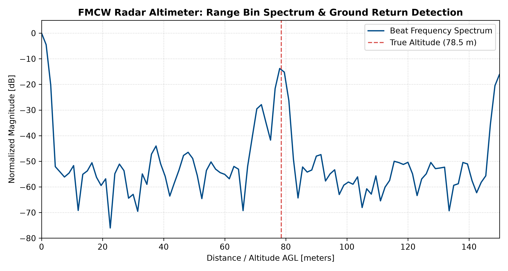

# FMCW Radar Altimeter: Signal Processing & Altitude Estimation Pipeline

A lightweight Python simulation of an aeronautical Frequency-Modulated Continuous-Wave (FMCW) radio altimeter operating in the **4.2–4.4 GHz** aeronautical radionavigation band.

This project models the end-to-end signal chain: chirp synthesis, ground reflection delay, direct antenna-to-antenna spillover (feedthrough), homodyne dechirping, windowed Range-FFT, and automated Above Ground Level (AGL) extraction.

---

## Output Visualization



*Figure: Dechirped beat frequency spectrum. Direct antenna bleedthrough dominates near 0 m (<3 m), while the true ground reflection is cleanly detected at 78.5 m AGL.*

---

## Technical Q&A (Avionics & Signal Processing Insights)

### Q1: Why use a Blackman window instead of a standard rectangular (no-window) FFT?
In FMCW radar, windowing addresses **spectral leakage** caused by taking the Fourier transform of a finite-duration signal:
* **The Rectangular Window Problem:** A default rectangular window has high sidelobes (the first sidelobe is only **-13 dB** down from the peak). Direct antenna spillover produces a massive signal spike near 0 Hz. If a rectangular window is used, the sidelobes of that spillover will smear across adjacent bins and completely drown out weak ground reflection returns from higher altitudes.
* **The Blackman Advantage:** A Blackman window drops sidelobes to approximately **-58 dB** down. While it slightly broadens the mainlobe width, this trade-off is essential in avionics to prevent high-amplitude near-field leakage from masking low-amplitude ground echoes.

### Q2: Why is there a spike near zero meters?
The spike at 0–2 meters represents **direct antenna-to-antenna coupling (spillover / bleedthrough)**:
* On an aircraft, the transmit (TX) and receive (RX) antennas are physically mounted only a short distance apart on the fuselage belly.
* A portion of the transmitted RF energy couples directly into the receiver without traveling to the ground. Because the travel distance is virtually zero, its round-trip time (**τ ≈ 0**) results in a beat frequency near 0 Hz.
* In avionics signal processing, this spike is mitigated using high-pass video filtering, Range-bin masking (**Range > 3 m**), or digital IQ baseline subtraction before peak extraction.

---

## Operating Principles & Theory

### 1. Linear Frequency Modulation Sweep Rate
The transmitter sweeps linearly over bandwidth **B** in duration **T꜀**:

**K = B / T꜀**

### 2. Time-of-Flight (Round Trip)
For an aircraft at altitude **R** Above Ground Level (AGL), where **c = 3.0 × 10⁸ m/s**:

**τ = (2 · R) / c**

### 3. Dechirping (Homodyne Mixing)
Multiplying the received delayed chirp with the transmitted local oscillator (LO) yields beat frequency **fᵦ**:

**fᵦ = K · τ = (2 · B · R) / (c · T꜀)**

### 4. Altitude Extraction
By computing the discrete Fourier transform (Range-FFT) of the dechirped intermediate frequency (IF) signal, peak frequency bins correspond directly to altitude:

**R = (c · fᵦ) / (2 · K)**

---

## Full Simulation Code (Python)

Dependencies: `numpy`, `scipy`, `matplotlib`

```python
import numpy as np
import matplotlib.pyplot as plt
from scipy.signal import butter, filtfilt

# 1. Radar Specifications (4.3 GHz Aeronautical Band)
c = 3.0e8              # Speed of light [m/s]
fc = 4.3e9             # Carrier frequency: 4.3 GHz
B = 100e6              # Sweep Bandwidth: 100 MHz
Tc = 1.0e-3            # Chirp duration: 1 ms
K = B / Tc             # Frequency sweep slope [Hz/s]
Fs = 2.0e6             # ADC Sampling Rate: 2 MHz
N = int(Fs * Tc)       # Samples per chirp
t = np.linspace(0, Tc, N, endpoint=False)

# 2. Flight Dynamics
true_altitude = 78.5   # Target height AGL [m]
tau = (2 * true_altitude) / c

# 3. Signal Synthesis
tx_signal = np.cos(2 * np.pi * (fc * t + 0.5 * K * t**2))
rx_ground = 0.6 * np.cos(2 * np.pi * (fc * (t - tau) + 0.5 * K * (t - tau)**2))
leakage = 1.4 * np.cos(2 * np.pi * (fc * t + 0.5 * K * t**2))  # Direct TX-RX bleedthrough
noise = 0.08 * np.random.normal(size=N)
rx_total = rx_ground + leakage + noise

# 4. Dechirping & Low-Pass Filtering
raw_beat = rx_total * tx_signal
b, a = butter(4, 0.35, btype='low')
filtered_beat = filtfilt(b, a, raw_beat)

# 5. Range FFT with Blackman Window
window = np.blackman(N)
spectrum = np.fft.rfft(filtered_beat * window)
freqs = np.fft.rfftfreq(N, d=1/Fs)
range_bins = (c * freqs) / (2 * K)

magnitude_db = 20 * np.log10(np.abs(spectrum) + 1e-9)
magnitude_db -= np.max(magnitude_db)

# 6. Peak Extraction (Masking Spillover < 3m)
valid_bins = range_bins > 3.0
peak_index = np.argmax(magnitude_db[valid_bins])
measured_altitude = range_bins[valid_bins][peak_index]

print(f"Target Height: {true_altitude:.2f} m | Detected Radar Height: {measured_altitude:.2f} m")

# 7. Visualization
plt.figure(figsize=(9, 4.8), dpi=150)
plt.plot(range_bins, magnitude_db, color='#004B87', lw=1.6, label='Beat Frequency Spectrum')
plt.axvline(true_altitude, color='#D9534F', linestyle='--', lw=1.4, label=f'True Altitude ({true_altitude} m)')
plt.xlim(0, 150)
plt.ylim(-65, 5)
plt.title('FMCW Radar Altimeter: Range Bin Spectrum & Ground Return Detection', fontsize=12, fontweight='bold')
plt.xlabel('Distance / Altitude AGL [meters]', fontsize=10)
plt.ylabel('Normalized Magnitude [dB]', fontsize=10)
plt.grid(True, linestyle=':', alpha=0.6)
plt.legend(loc='upper right')
plt.tight_layout()
plt.savefig('fmcw_altimeter_result.png', dpi=300)
plt.show()
